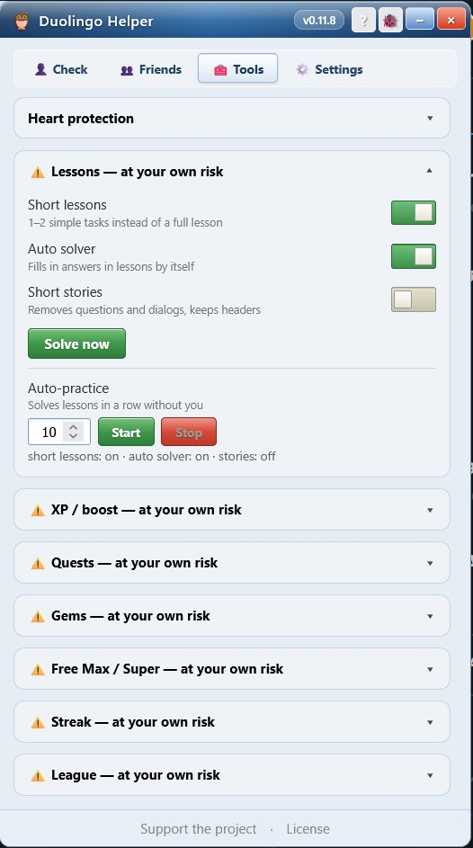
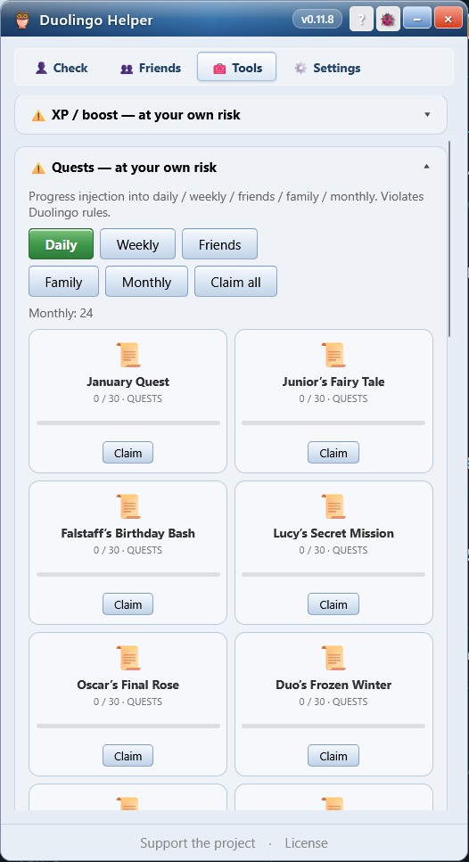
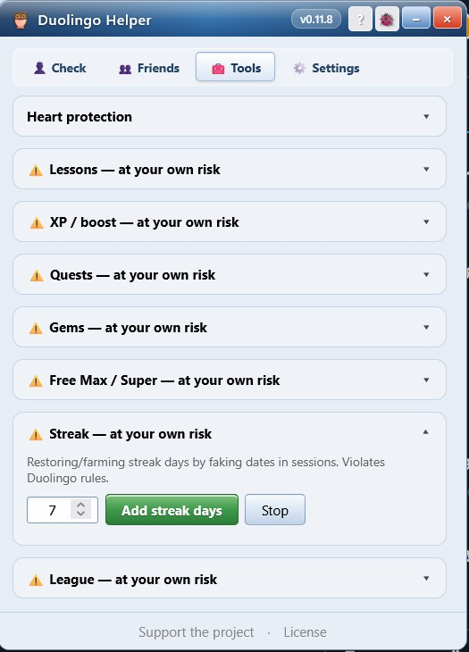
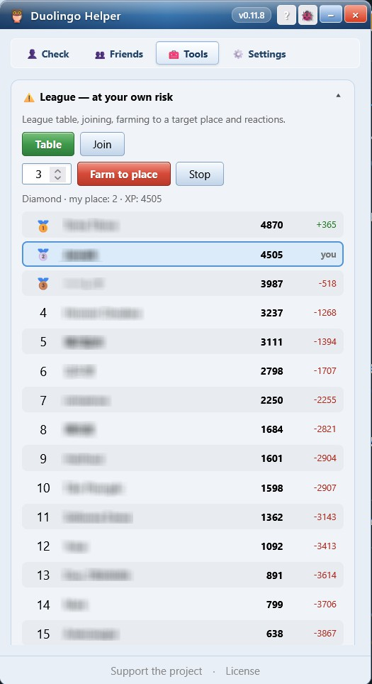
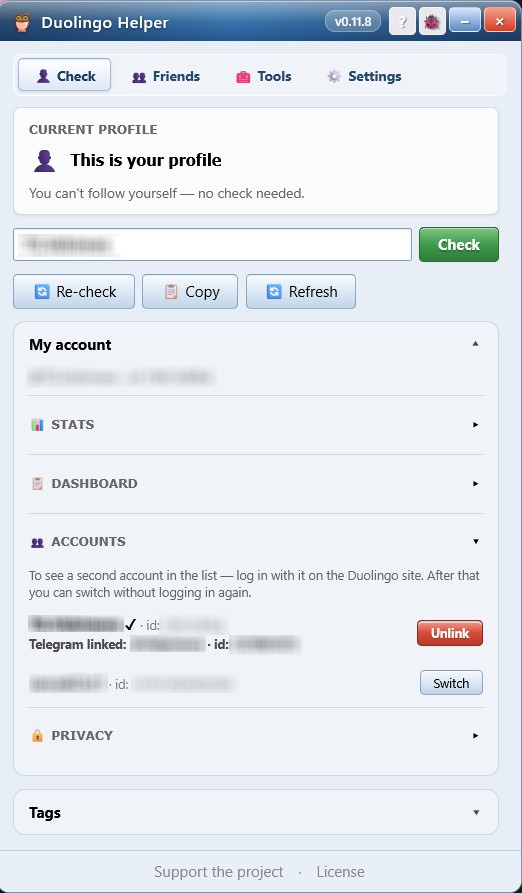

<p align="center"></p>

# 🦉 Duolingo Helper

**English** | [Русский](README.ru.md)

A userscript for Tampermonkey — an extension for Duolingo with follow-back checking, user tagging and tools for managing friends. A themed window (10 themes), badges on profiles, custom tags.

> Version: 0.11.9 | Works on `*.duolingo.com`

---

## 📋 Contents

- [Installation](#installation)
- [Features](#features)
  - [Window and themes](#window-and-themes)
  - [Follow-back check on profiles](#follow-back-check-on-profiles)
  - [User tags](#user-tags)
  - [Friends list](#friends-list)
  - [Manual check](#manual-check)
  - [Cache and settings](#cache-and-settings)
  - [Updates](#updates)
  - [Export and import](#export-and-import)
  - [Cloud saves](#cloud-saves)
  - [Heart protection](#heart-protection)
  - [Lessons](#lessons)
  - [XP / boost](#xp--boost)
  - [Quests](#quests)
  - [Gems](#gems)
  - [Free Max / Super](#free-max--super)
  - [Streak](#streak)
  - [League](#league)
  - [Accounts](#accounts)
  - [Telegram bot](#telegram-bot)
- [Data storage](#data-storage)

---

## Installation

**Step 1.** Install the Tampermonkey extension for your browser:

- [Chrome / Edge / Opera](https://www.tampermonkey.net/)
- [Firefox](https://www.tampermonkey.net/?browser=firefox)

**Step 2.** Press the button below to install the script:

[](https://raw.githubusercontent.com/Vidrimers/Duolingo-helper/refs/heads/master/duo-helper.user.js)

> When you open the link, Tampermonkey recognizes the script automatically and opens the install dialog. Press **"Install"**.

**Step 3.** Open [duolingo.com](https://www.duolingo.com) (you must be logged in). A 🦉 button appears in the bottom-left corner.

---

## Features

### Window and themes

<p align="center"></p>

The script panel is a draggable window with ten themes (Win95 by default): titlebar, frame, minimize/close buttons.

- The window **can be dragged by the titlebar** anywhere on the page
- The position is remembered after dragging and restored on reload
- The **"Reset"** button in settings returns the window to its default place

**Themes** — in settings:

| Theme              | Look                                                  |
| ------------------ | ----------------------------------------------------- |
| **Win95** (default) | Classic: grey `#C0C0C0`, blue titlebar, 3D buttons    |
| **WinXP**          | Luna: blue titlebar, grey body `#ECE9D8`              |
| **Vista**          | Aero: glass titlebar, light background, rounded corners |
| **Win11**          | Fluent / Mica: white background, Segoe UI, 8px radii  |
| **Material 3 Light** | Google M3 Expressive: purple accents, pills, 12–28px |
| **Material 3 Dark**  | Google M3 Expressive dark: same roles, inverted tones |
| **MacOS**          | Metal, traffic lights 🔴🟡🟢, Helvetica, rounded corners |
| **iOS old**        | iOS 6: glossy gradients, pinstripes, rounded          |
| **iOS Liquid Glass** | Apple Liquid Glass: glass, blur, gradient, glare      |
| **Die my Darling** | Blood red: dark background, red accents, gothic       |

In the window titlebar: **`?`** — about the script and its features, **`🐞`** — a bug report to GitHub Issues (template pre-filled). In the footer: **"Support the project"** and **"License"**.

### Follow-back check on profiles

<p align="center">  </p>

When you open a user's page (`/profile/name`), the script automatically checks whether that person follows you back.

The badge is inserted **directly into the layout next to the user's name** (matching the profile URL) and is part of the profile header — it scrolls together with the name.

- ✅ **Follows you** — green
- ❌ **Doesn't follow you** — red
- ⏳ Checking…

If the name can't be found on the page, the badge is shown temporarily in the corner of the screen. Clicking the badge opens the control panel.

### User tags

<p align="center"></p>

In the **"Check"** tab, the **"Tags"** block — text, color and a note for the current profile. Next to it is a **"Tagged people"** link with a list and a **"← Back"** button.

| What               | Description                                          |
| ------------------ | ---------------------------------------------------- |
| ✏ in friends       | Add/edit a tag from the friends list (modal)         |
| Tags in "Check"    | A form for the current profile: text, color, note    |
| Tagged people      | A list of all tags; a click opens the profile        |
| On the profile     | The tag is shown next to the follow status           |

A tag is keyed to `userId` — it survives name and username changes. A change is written to "Changes" when a user renames themselves.

### Friends list

The **"👥 Friends"** tab:

| What                                  | Description                                                                                                          |
| ------------------------------------- | -------------------------------------------------------------------------------------------------------------------- |
| Refresh                               | Fetches following + followers, stitched by userId                                                                     |
| Filters                               | All / ❌ not following back / ✅ mutual / 📊 activity                                                                   |
| Activity                              | Streak, XP, days inactive + sorting (XP / days / name). No action buttons on rows                                      |
| Search                                | By name and username                                                                                                 |
| Check activity                        | Scans following ∪ followers (threshold in settings)                                                                   |
| Unfollow / block inactive             | Mass actions in "Activity", respecting 🛡 exceptions                                                                  |
| Unfollow                              | A button on every friend                                                                                             |
| Unfollow non-followers ❌              | Mass unfollow of those who don't follow you back                                                                      |
| Unfollow everyone                     | A quiet link under "All": unfollows every subscription (double confirmation, 🛡 exceptions untouched)                  |
| History                               | A list of actions + "Undo"                                                                                           |
| Changes                               | Who followed / unfollowed / renamed. A red counter for new ones; new rows are highlighted, hovering clears it          |
| Exceptions                            | 🛡 shield — never touched by mass operations; with a counter                                                          |
| Blocks                                | A local block list: unblock, counter                                                                                 |

`✅` — the person follows you back. `❌` — no. Every unfollow is written to history and can be undone.

### Manual check

In the panel (🦉 button → **"Check"** tab) you can enter any username and check it without visiting the profile. Also there:

- the current profile's status
- a row of buttons: **"Re-check"** (clears the cache) · **"Copy"** · **"Refresh"** (reloads the page)
- a card with your account (username + id)

### Cache and settings

<p align="center"></p>

The **"Settings"** tab:

| Parameter                     | Description                                                      |
| ----------------------------- | ---------------------------------------------------------------- |
| Auto-check on profile         | Check the follow-back automatically when opening a profile       |
| Show badge                    | A badge next to the name on the profile                          |
| Start state                   | Remember last / Closed / Minimized / Open                        |
| Window theme                  | Win95 / WinXP / Vista / Win11 / M3 Light / M3 Dark / Liquid Glass / MacOS / iOS old / Die my Darling |
| Язык / Language               | Русский / English (the script's UI; the bot's messages follow it too) |
| Cache (minutes)               | Don't re-request the API while the result is fresh (default 30)  |
| Inactive, days                | Threshold for the "Inactive" filter (default 7)                  |
| Delay between requests (ms)   | A pause during mass polling/operations (rate limit)              |
| Notifications, sec            | How long notifications stay visible (1–30, default 5)            |
| Leaderboard refresh, sec      | How often XP gaps refresh on the leaderboard (1–60, default 2)   |
| Reset window position         | Return the window to its default place                           |
| Clear cache                   | Delete saved check results                                       |
| Data                          | The **"Export"** and **"Import"** JSON buttons                    |

### Updates

The script quietly checks GitHub for a new version (no more than once a day). If an update is available, a green banner appears at the top of the panel:

```
🆕 Update available: v0.2.9 → v0.3.0   [⬆️ Install]
```

The **"Install"** button opens the file for Tampermonkey and **reloads the page itself** after 8 seconds (with a countdown) — then the new version works. The **"Check for updates"** button in settings checks manually.

### Export and import

The buttons are at the **bottom of the "Settings" tab** (the "Data" block):

| Button     | Action                                                                       |
| ---------- | ---------------------------------------------------------------------------- |
| 📥 Export  | A modal: pick accounts, JWT, password encryption. File `duolingo-helper-accounts-{date}.json` |
| 📥 Import  | Format v2 (multi-account) and v1 (single account). Encrypted JWTs — password prompt |

**Export** — one file for all accounts. Checkboxes:
- **Include JWTs** — save the account tokens (to move multi-account setups)
- **Encrypt with a password** — AES-256-GCM. Without the checkbox — JWTs in plain text (with a warning)

The password is never saved anywhere — only during export/import.

### Cloud saves

The **"Cloud saves"** block at the bottom of the "Settings" tab — a backup of all accounts on the bot's server (the same v2 format as export, with JWTs). **One backup per account** is stored (saving again overwrites it). The **"Save"**, **"Restore"** and **"Delete"** buttons are available only after linking Telegram; without a link they are disabled with a tooltip ("Delete" is also disabled while there is no backup). The data is encrypted on the server (AES-GCM), and the backup is deleted when the account is unlinked.

### Heart protection

<p align="center"></p>

The **"Tools"** tab — blocks heart-spending requests on mistakes in lessons (`remove-heart`). Hearts stay where they are.

- The **"Block heart spending"** toggle (enabled by default)
- Works by intercepting `fetch` / `XHR` on the Duolingo page
- **UI sync**: during a lesson the counter is kept equal to the server (a local drop is rolled back), after the lesson — reconciled via the API
- Can be turned off at any moment, without a reload

> This protects the game's mechanics in your own account, not farming. Still, interfering with the site can formally break Duolingo's rules — at your own risk.

### Lessons

<p align="center"></p>

> ⚠️ **Cheats. At your own risk.** Shortening lessons and the auto solver break Duolingo's rules. **Disabled by default.**

| Parameter        | Description                                                                                       |
| ---------------- | ------------------------------------------------------------------------------------------------- |
| Short lessons    | `POST /sessions` returns 1–2 simple tasks instead of a full lesson                                 |
| Auto solver      | Complete: choice, translate, match, tap, cloze, tables, stories, reverse translate, name+article   |
| Short stories    | Removes questions and dialogs from a story, keeping only the headers                               |
| Solve now        | Force-solve the current task                                                                       |
| Auto-practice    | Solves N lessons in a row (a count field), Start / Stop buttons                                    |

The auto solver runs in the background on `/lesson` and `/practice` when enabled.

The blocks in "Tools" are an **accordion**: one opens at a time, the rest collapse.

### XP / boost

<p align="center"></p>

> ⚠️ **Cheats. At your own risk.** The field is the XP target (how much to earn).

| What     | Description                                                                           |
| -------- | ------------------------------------------------------------------------------------- |
| Stories  | XP farming via `stories/.../complete` (~50+ XP per run)                               |
| Sessions | XP farming via `POST/PUT /sessions` (`UNIT_TEST` + bonuses), verified against `totalXp` |

### Quests

<p align="center"></p>

> ⚠️ **Cheat. At your own risk.** Progress injection into quests via `goals-api.duolingo.com`. Breaks Duolingo's rules, the account may be banned.

The **"Tools"** tab:

| Button       | Action                                             |
| ------------ | -------------------------------------------------- |
| Daily        | Closes all unfinished daily quests with one button |
| Monthly      | Loads the list of monthly quests with progress     |
| Claim all    | Completes all unfinished monthlies in a row        |
| GET on a quest | Completes one specific monthly quest             |

### Gems

> ⚠️ **Cheat. At your own risk.** Collecting `rewardBundles` (`SKILL_COMPLETION`) via PATCH `/rewards/{id}`. Breaks Duolingo's rules.

**Gems are diamonds** (the premium currency).

| Button   | Action                                          |
| -------- | ----------------------------------------------- |
| Collect  | Claim all available gem rewards once            |
| Farm     | Loops the collection while rewards are available |
| Farm ×8  | 8 parallel requests — faster but riskier        |
| Stop     | Stop farming                                    |

### Free Max / Super

> ⚠️ **Cheat. At your own risk.** Replaces the `GET /users` response — the client sees Super/Max. Unlocks client-side features (unlimited hearts, premium sections), but doesn't grant a server subscription.

| Button           | Action                                          |
| ---------------- | ----------------------------------------------- |
| Free Max / Super | Toggle the `hasPlus` + `gold_subscription` spoof |

### Streak

<p align="center"></p>

> ⚠️ **Cheat. At your own risk.** Farming/restoring streak days via `POST/PUT /2017-06-30/sessions` with faked dates. Breaks Duolingo's rules.

| Button          | Action                                                              |
| --------------- | ------------------------------------------------------------------- |
| Add streak days | Creates practice sessions with `endTime` in the past (account TZ)   |
| Stop            | Interrupt                                                           |

The input is the number of days (1–365).

### League

<p align="center"></p>

| Button          | Action                                                     |
| --------------- | ---------------------------------------------------------- |
| Table           | Cards with top-3 medals, "you" highlighted, gap to neighbor |
| Join            | Join the weekly league                                     |
| Farm to place   | Farms XP via stories until you reach the place (cheat)     |
| Stop            | Interrupt the farm                                         |

**XP gaps on the page** — when opening `duolingo.com/leaderboard`, the gap (+/− XP vs you) is shown automatically next to each player.

---

### Accounts

<p align="center"></p>

| Feature | Description |
|---|---|
| Multi-account switcher | A list of accounts, switching without logging in again |
| Account dashboard | Stats: streak, XP, update date, deletion |
| Privacy: hide profile | Managing Duolingo privacy settings |
| Telegram linking | The "Link Telegram" button (on the active profile) → deep link into the bot |

### Telegram bot

<p align="center">  </p>

[@Duolingo_Helperbot](https://t.me/Duolingo_Helperbot) — manage your Duolingo account through Telegram.

**Menu (inline buttons):**
- 📊 **Stats** — XP, league XP, streak, day status, a 7-day chart, the "Get XP" and "Streak" buttons (farming, at your own risk), "Donate"
- 🏆 **League** — a table with gaps, farming to a target place
- 👥 Friends — following/followers, unfollowing non-followers, activity check (the threshold is chosen before the check), unfollow/block inactive (🛡 exceptions from the script's settings; actions land in the script's "History" with undo)
- ⚙️ Settings — notifications (time to practice, league overtake, who followed/unfollowed, weekly digest, script updates), linking (status, unlink with data deletion)
- 🌐 Open site — a link to duolingo.com
- 🔧 Admin panel (for the administrator only)

**Commands:** `/start`, `/help`, `/status`, `/bugreport`, `/unlink`

**Language:** the bot's messages follow the script's language ("Settings → Язык / Language": Русский / English); the admin panel is always in Russian.

**Linking:** the "Link Telegram" button in the script → deep link → the bot.
**Bug report:** the 🐞 button in the script → choose GitHub / Telegram → `/bugreport` in the bot.

> The section grows as bot features are added.

## Data storage

**The script** — settings, tags, friends, action history and statistics are stored in Tampermonkey storage (`GM_setValue`) — they survive clearing browser cookies and cache.

**The bot** — after linking Telegram, the bot's server stores: Duolingo ID and name, TG ID, an encrypted JWT (AES-GCM), and synced XP statistics. As you use it, notification settings, the mass-action history (for undo in the script), friend activity scan results and bug reports also accumulate. The JWT is stored only in encrypted form and is used exclusively for Duolingo API requests on your behalf — stats, league, farming, background notifications. It never appears in logs or in the bot's replies. When the account is unlinked, all of this data is deleted from the server.

**Export** — the v2 format (multi-account). JWTs are optional; when encrypted with a password they are stored as `jwt_encrypted` (AES-256-GCM, the password is never stored):

```json
{
  "type": "duolingo-helper-accounts",
  "version": 2,
  "encrypted": true,
  "accounts": [
    {
      "id": "123456",
      "username": "my_username",
      "label": "Main",
      "data": { "settings": {}, "userTags": {}, "actionLog": [], "stats": {} },
      "jwt_encrypted": { "salt": "…", "iv": "…", "data": "…" }
    }
  ]
}
```

> ⚠️ The Duolingo API is unofficial. Mass actions (deletion, unfollowing) are performed carefully with random delays. The JWT is not sent to third parties and does not end up in logs.

---

## License

**CC BY-NC-ND 4.0** — [Creative Commons Attribution-NonCommercial-NoDerivatives 4.0](https://creativecommons.org/licenses/by-nc-nd/4.0/)

| | |
|---|---|
| ✅ Use for free | ✅ |
| ✅ Share with attribution | ✅ |
| ❌ Commercial use | ❌ |
| ❌ Modifications and derivatives | ❌ |

**For commercial use** — contact the author to obtain a license.
